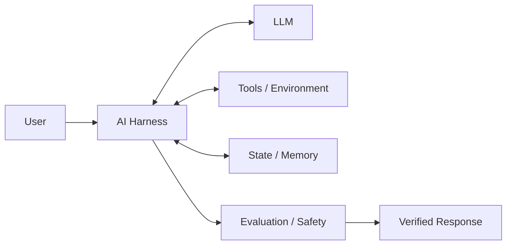

# AI Harness

A hands-on project for learning and building **AI harnesses**: the software around an LLM that turns raw model output into a reliable application.

---

## What is an AI harness?

An **AI harness** (also called an *agent harness*) is the infrastructure built around an AI model. If the **LLM is the brain**, the harness is the **body and workplace**: the tools it uses, the memory it keeps, and the rules it follows.

A production system is not just `User → LLM → Response`. It looks closer to this:



### Core concepts

| Concept | What it means |
| --- | --- |
| **Tools** | Functions the model can call (APIs, database lookups, sandboxes). The harness validates arguments, runs the tool and returns the result. |
| **Reason → Act → Observe loop** | The model decides on an action, the harness executes it, and the result goes back to the model, which repeats until it has a final answer. |
| **State and memory** | Short-term conversation history (and optionally long-term memory), kept per session or thread, so context carries across turns. |
| **Control** | Instructions and permissions that limit what the agent may do, for example a system prompt such as "only refund active subscribers". |
| **Guardrails (safety)** | Checks that run outside the model, before an action or reply reaches the real world: policy rules, classifiers, permission scopes. They enforce what the prompt only requests. |
| **Evaluation** | Validating output quality and safety, using deterministic checks, ML classifiers, or an LLM acting as a judge. |
| **Reliability** | Retries, timeouts, fallbacks and recovery when a step fails. |
| **Observability** | Tracing actions, tool calls, outputs and evaluation results so behaviour can be debugged and audited. |

### Two kinds of harness

| | Agent runtime harness | Evaluation harness |
| --- | --- | --- |
| **Purpose** | Run an agent safely in production | Measure model or agent quality |
| **When it runs** | At request time | During development and CI/CD |

#### 1. Agent Runtime Harness (Execution & Control)

In production, the harness gives an agent the environment, context management, and guardrails it needs to complete multi-step tasks safely.

**Key functions**

- **Tool and environment execution:** Isolated sandboxes (for example Docker containers) let agents run code, call APIs, or query databases safely.
- **The Reason → Act → Observe loop:** The harness captures the model's intended action, runs the tool, and feeds the observation back so the model can choose the next step.
- **Memory and context control:** It manages short-term history and long-term memory, summarizing or pruning long traces to fit the context window.
- **Guardrails and security:** It enforces safety rules, permission scopes, prompt-injection defenses, and compliance checks _before_ an action touches the real world.

#### 2. Evaluation Harness (Testing & Quality)

In AI development and LLMOps, an **eval harness** is a structured framework for benchmarking models or agents against defined metrics.

**Key functions**

- **Automated benchmarking:** Runs hundreds of test cases on every model or prompt change.
- **Multi-method scoring:** Combines exact-match rules, code execution, heuristics, and LLM-as-a-Judge evaluation.
- **Regression testing:** Runs in CI/CD to catch safety downgrades, hallucination spikes, or accuracy drops before deployment.

A well-known open-source example is EleutherAI's [lm-evaluation-harness](https://github.com/EleutherAI/lm-evaluation-harness), used across the industry to benchmark open models on standard academic tasks.

This repository focuses on the **runtime harness**. For the full background, patterns (single-agent, multi-agent pipelines, LLM-as-a-Judge) and the production hardening checklist, see the [high-level plan](./docs/ai-harness-high-level-plan.md).

### Why the harness matters

As raw model quality converges across top providers, the **harness** often decides whether a solution works in production. The differences come from how well it:

- handles errors and retries failed actions,
- manages state,
- verifies output before returning it.

---

## Implementations

We are building **multiple implementations** of the harness, each adding more capability. Each version has its own source folder under `src/` and its own design document under `docs/`.

| Version | Status | Summary | Docs |
| --- | --- | --- | --- |
| **v1** | Available | Single-agent customer-support harness: tools, per-thread memory, and a two-layer guardrail (policy rules + moderation classifier) | [docs/version1.md](./docs/version1.md) |
| v2+ | Planned | To be announced | n/a |

### Version 1 at a glance

A customer-support agent built with TypeScript, LangChain and OpenAI that can look up a subscription and issue a refund:

- **Tools:** `fetch_user_subscription` and `process_refund` (mocked, Zod-validated).
- **Memory:** `MemorySaver` keeps conversation history per `thread_id`.
- **Guardrail:** after the agent finishes, deterministic policy rules (verified active subscription, refund cap, no secret leakage) and an OpenAI moderation classifier decide whether the reply may be returned. It fails closed.

Code lives in [`src/v1`](./src/v1). Read [docs/version1.md](./docs/version1.md) for the flow diagram, step-by-step explanation, design decisions and known limitations.

### Running version 1

Prerequisites: Node.js 18+ and an OpenAI API key.

```powershell
npm install
```

Create a `.env` file in the project root (it must not be committed):

```bash
OPENAI_API_KEY=your_key_here
```

Then run:

```powershell
npm run harness
```

---

## Branching model

- **One branch per version** (for example `v1`, `v2`): each version is developed and iterated on its own branch.
- **`main` holds all the code**: finished versions are merged into `main`, so it contains every version side by side (`src/v1`, `src/v2`, ...) along with the docs.

To work on a version, check out its branch. To see everything, use `main`.

---

## Repository layout

```text
.
├── docs/
│   ├── ai-harness-high-level-plan.md   # Concepts, patterns, target architecture
│   └── version1.md                     # Solution document for v1
├── src/
│   └── v1/                             # Version 1 implementation
└── README.md
```
