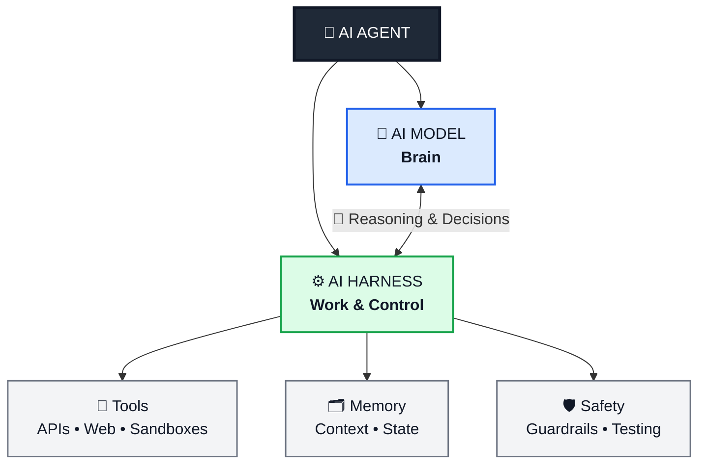
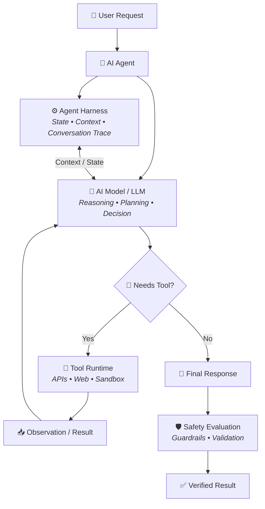
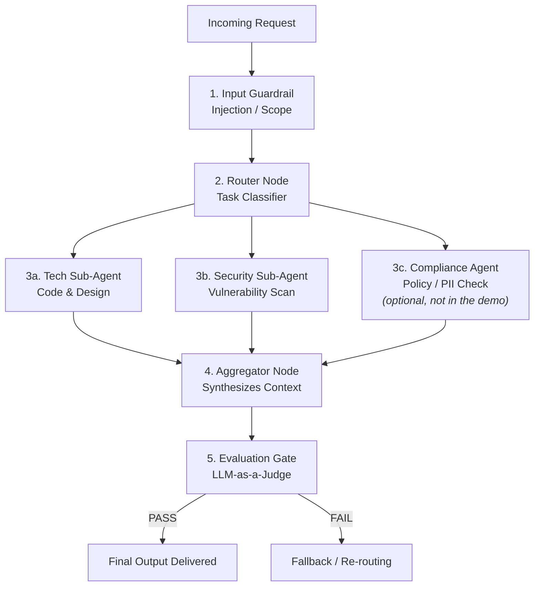
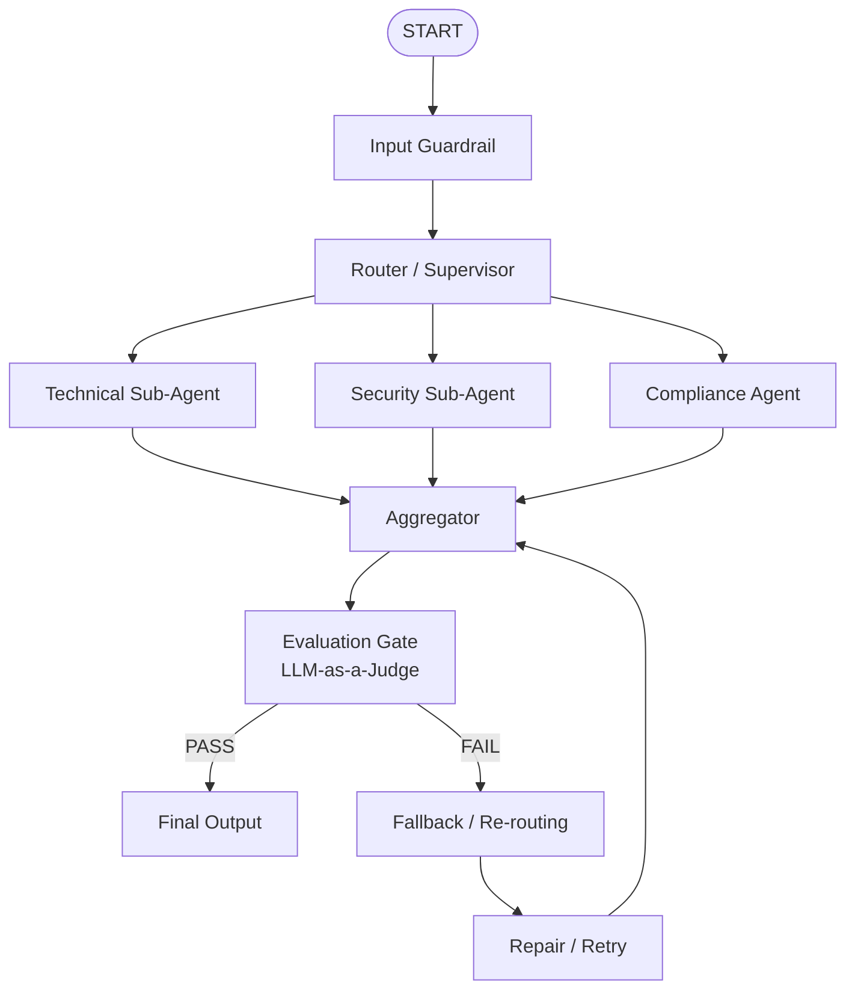
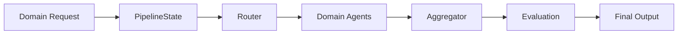
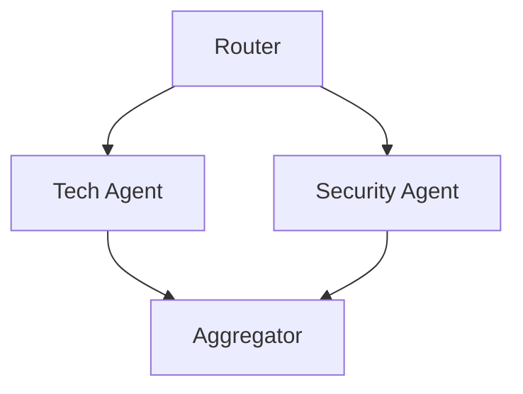
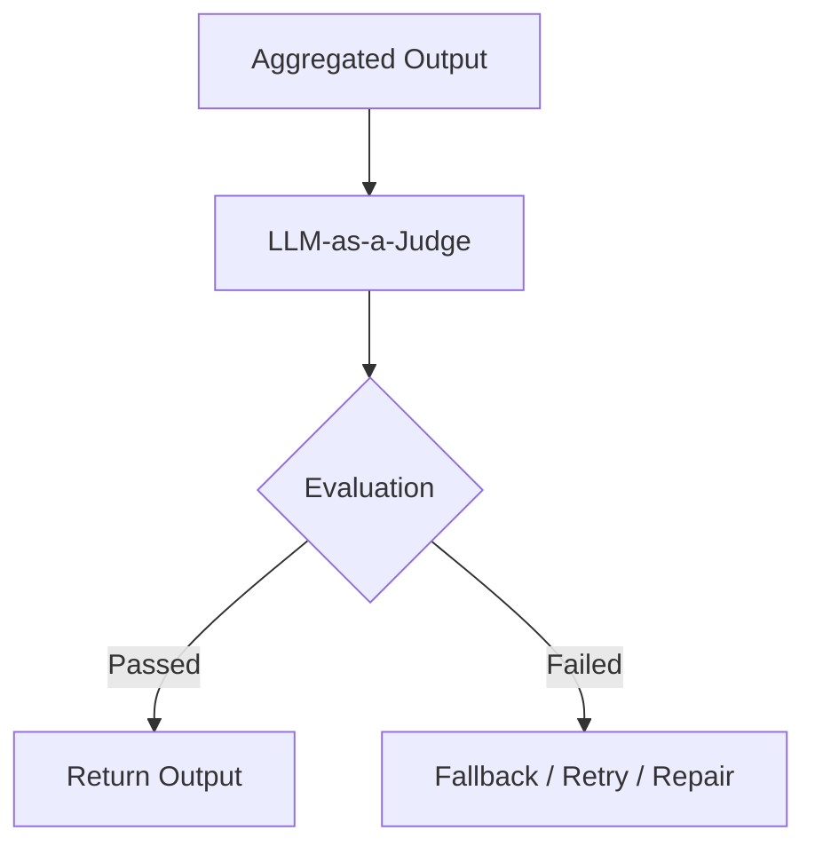
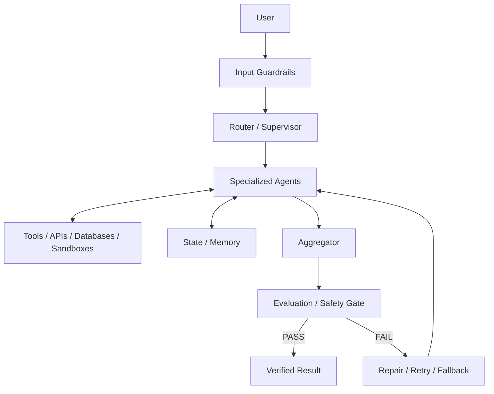
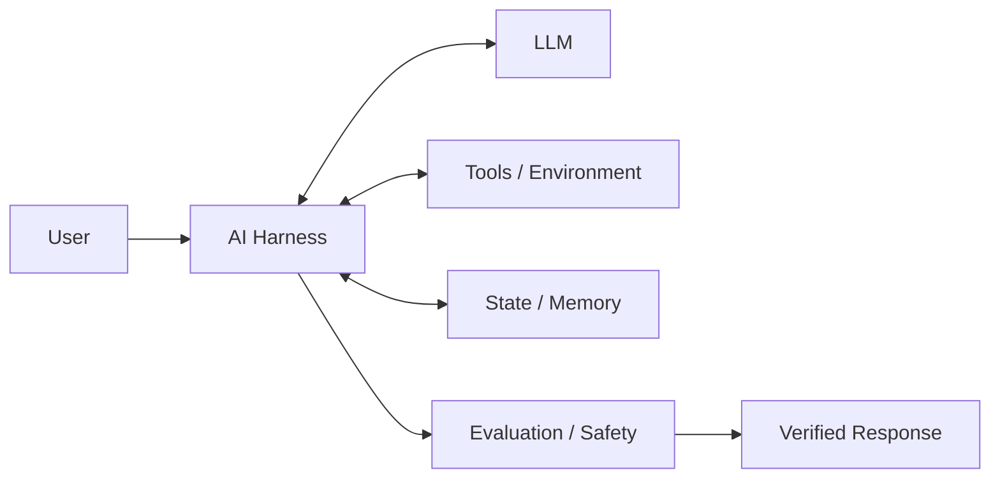

# Understanding the AI Harness

An **AI harness** (also called an **agent harness** or **evaluation harness**) is the software infrastructure built around an AI model. It turns the model's raw reasoning into a reliable, real-world application.

If the **LLM** is the **brain**, the harness is the **body and workplace** around it: the tools it uses, the memory it keeps, and the rules it follows.



---

## Table of Contents

1. [Two Kinds of AI Harness](#two-kinds-of-ai-harness)
2. [Why the Harness Matters](#why-the-harness-matters)
3. [Example 1: A Single-Agent Harness](#example-1-a-single-agent-harness)
4. [Example 2: A Multi-Agent Pipeline Harness](#example-2-a-multi-agent-pipeline-harness)
5. [Architectural Insights](#architectural-insights)
6. [Summary](#summary)

---

## Two Kinds of AI Harness

The term covers two related concepts:

| | Agent Runtime Harness | Evaluation Harness |
| --- | --- | --- |
| **Purpose** | Run an agent safely in production | Measure model or agent quality |
| **When it runs** | At request time | During development and CI/CD |
| **Typical tools** | LangGraph, AutoGen (AG2), CrewAI, Semantic Kernel | lm-evaluation-harness, custom eval suites |

### 1. Agent Runtime Harness (Execution & Control)

In production, the harness gives an agent the environment, context management, and guardrails it needs to complete multi-step tasks safely.

**Key functions**

- **Tool and environment execution:** Isolated sandboxes (for example Docker containers) let agents run code, call APIs, or query databases safely.
- **The Reason → Act → Observe loop:** The harness captures the model's intended action, runs the tool, and feeds the observation back so the model can choose the next step.
- **Memory and context control:** It manages short-term history and long-term memory, summarizing or pruning long traces to fit the context window.
- **Guardrails and security:** It enforces safety rules, permission scopes, prompt-injection defenses, and compliance checks *before* an action touches the real world.

### 2. Evaluation Harness (Testing & Quality)

In AI development and LLMOps, an **eval harness** is a structured framework for benchmarking models or agents against defined metrics.

**Key functions**

- **Automated benchmarking:** Runs hundreds of test cases on every model or prompt change.
- **Multi-method scoring:** Combines exact-match rules, code execution, heuristics, and LLM-as-a-Judge evaluation.
- **Regression testing:** Runs in CI/CD to catch safety downgrades, hallucination spikes, or accuracy drops before deployment.

A well-known open-source example is EleutherAI's [lm-evaluation-harness](https://github.com/EleutherAI/lm-evaluation-harness), used across the industry to benchmark open models on standard academic tasks.

---

## Why the Harness Matters

As raw model quality converges across top providers, the **harness** often decides whether a solution works in production. The differences come from how well it:

- handles errors and retries failed actions,
- manages state,
- verifies output before returning it.

---

## Example 1: A Single-Agent Harness

This section builds a customer-support agent with **TypeScript, Node.js, LangChain, and LangGraph** (`@langchain/langgraph`).

### Architectural flow

The harness governs the **Reason → Act → Observe** lifecycle:



### Setup

Prerequisites: Node.js 18+ and an OpenAI API key.

```powershell
npm init -y
npm install @langchain/core @langchain/openai @langchain/langgraph zod dotenv
npm install -D typescript @types/node tsx
npx tsc --init
```

Create a `.env` file in the project root. Add it to `.gitignore` so the key is never committed.

```bash
OPENAI_API_KEY=your_actual_openai_api_key_here
```

### Code: `agentHarness.ts`

```ts
import { ChatOpenAI } from "@langchain/openai";
import { tool } from "@langchain/core/tools";
import { createReactAgent } from "@langchain/langgraph/prebuilt";
import { MemorySaver } from "@langchain/langgraph";
import { HumanMessage } from "@langchain/core/messages";
import { z } from "zod";
import * as dotenv from "dotenv";

dotenv.config();

// ============================================================================
// 1. TOOL DEFINITIONS
// ============================================================================

// Tool 1: database lookup (simulated)
const fetchUserSubscriptionTool = tool(
  async ({ userId }: { userId: string }) => {
    console.log(`\n[Harness Executing Tool]: Fetching DB info for user ${userId}...`);

    const mockDb: Record<string, { plan: string; status: string }> = {
      user_123: { plan: "Pro Tier", status: "active" },
      user_456: { plan: "Free Tier", status: "canceled" },
    };

    const user = mockDb[userId] ?? { plan: "Unknown", status: "not_found" };
    return JSON.stringify(user);
  },
  {
    name: "fetch_user_subscription",
    description:
      "Fetches user subscription details from the internal database given a user ID.",
    schema: z.object({
      userId: z.string().describe("The user ID to fetch details for"),
    }),
  }
);

// Tool 2: external action (simulated refund)
const processRefundTool = tool(
  async ({ userId, amount }: { userId: string; amount: number }) => {
    console.log(`\n[Harness Executing Tool]: Processing $${amount} refund for ${userId}...`);

    return JSON.stringify({ status: "success", refundId: `ref_${Date.now()}` });
  },
  {
    name: "process_refund",
    description: "Processes a payment refund for a specific user ID.",
    schema: z.object({
      userId: z.string().describe("Target user ID"),
      amount: z.number().positive().describe("Amount to refund in USD"),
    }),
  }
);

const tools = [fetchUserSubscriptionTool, processRefundTool];

// ============================================================================
// 2. HARNESS SETUP
// ============================================================================

// A. Brain: the LLM
const model = new ChatOpenAI({ model: "gpt-4o-mini", temperature: 0 });

// B. Persistence: conversation state per thread
const checkpointer = new MemorySaver();

// C. System instructions / guardrails
const systemPrompt = `
You are a Customer Support AI Agent operating inside a secure enterprise harness.

RULES:
1. Always verify the user's subscription status with 'fetch_user_subscription'
   BEFORE performing any action.
2. Only issue refunds if the user's subscription status is 'active'.
3. Be professional and concise.
`;

// D. The agent itself
const harnessAgent = createReactAgent({
  llm: model,
  tools,
  checkpointer,
  prompt: systemPrompt,
});

// ============================================================================
// 3. EVALUATION / GUARDRAIL LAYER
// ============================================================================

async function runHarnessTask(threadId: string, userInput: string) {
  console.log("\n======================================================");
  console.log(`[USER INPUT]: "${userInput}"`);
  console.log("======================================================");

  const config = { configurable: { thread_id: threadId } };

  // Step 1: run the agent loop
  const result = await harnessAgent.invoke(
    { messages: [new HumanMessage(userInput)] },
    config
  );

  const finalMessage = result.messages[result.messages.length - 1];
  const finalContent = finalMessage.content.toString();

  // Step 2: post-execution safety check (demo only; use a real
  // classifier or policy engine in production)
  const passesGuardrail = !finalContent
    .toLowerCase()
    .includes("unauthorized_access_code");

  if (!passesGuardrail) {
    console.error("[Harness Safety Evaluation]: BLOCKED response due to policy violation.");
    return "Error: Output blocked by safety evaluation guardrail.";
  }

  console.log(`\n[FINAL HARNESS OUTPUT]:\n${finalContent}`);
  return finalContent;
}

// ============================================================================
// 4. EXECUTION DEMO
// ============================================================================

async function main() {
  const sessionThreadId = "session_user_123_abc";

  // Turn 1: triggers both tools
  await runHarnessTask(
    sessionThreadId,
    "Hi, my user ID is user_123. Can you please refund $50 for my last invoice?"
  );

  // Turn 2: answered from memory in the same thread
  await runHarnessTask(
    sessionThreadId,
    "What was the refund status and ID you just generated?"
  );
}

main().catch(console.error);
```

> **Note:** LangGraph's prebuilt agent API changes between versions. This example uses the `prompt` and `checkpointer` options. Older releases used `messageModifier` and `checkpointSaver`.

### Run it

```powershell
npx tsx agentHarness.ts
```

### What this example demonstrates

| Capability | Purpose |
| --- | --- |
| **State persistence** | `MemorySaver` keeps thread context, so you don't resend the full history on every call. |
| **Schema-validated tools** | Zod validates tool parameters before execution. |
| **Tool execution loop** | Tool results feed straight back into the ReAct loop. |
| **Post-evaluation layer** | A wrapper outside the agent audits responses before they reach the user. |

---

## Example 2: A Multi-Agent Pipeline Harness

A generic, pipeline-style harness goes beyond a single agent loop into a **multi-agent workflow graph**. Production LLMOps systems typically combine three patterns:

1. **Router / Supervisor:** Directs incoming tasks to specialized sub-agents.
2. **Parallel sub-agent execution (scatter-gather):** Runs independent agents concurrently to cut latency.
3. **Sequential aggregation and evaluation:** Merges the parallel outputs, then passes the result through safety and quality gates.

### Architecture



### Core concepts

| Component | Responsibility | Implementation |
| --- | --- | --- |
| **Pipeline state** | Shared context passed between nodes | `Annotation.Root` |
| **Parallel sub-agents** | Independent reasoning units running concurrently | Branching nodes, each wrapping a ReAct agent |
| **Aggregator** | Merges parallel outputs into one response | Fan-in node that reads all branch results from state |
| **Evaluation gate** | Quality and safety check outside the agent logic | LLM judge with Zod-structured output |

### Setup

Use the same dependencies and `.env` file as Example 1.

### Code: `genericHarnessPipeline.ts`

```ts
import { ChatOpenAI } from "@langchain/openai";
import { tool } from "@langchain/core/tools";
import { createReactAgent } from "@langchain/langgraph/prebuilt";
import { StateGraph, Annotation, END, START } from "@langchain/langgraph";
import {
  HumanMessage,
  BaseMessage,
  SystemMessage,
} from "@langchain/core/messages";
import { z } from "zod";
import * as dotenv from "dotenv";

dotenv.config();

// ============================================================================
// 1. PIPELINE STATE DEFINITION
// ============================================================================

const PipelineState = Annotation.Root({
  // Core user input
  request: Annotation<string>(),

  // Accumulated messages across nodes
  messages: Annotation<BaseMessage[]>({
    reducer: (x, y) => x.concat(y),
    default: () => [],
  }),

  // Routes chosen by the router node
  routingChoice: Annotation<string[]>({
    reducer: (_x, y) => y,
    default: () => [],
  }),

  // Parallel sub-agent outputs
  techAnalysis: Annotation<string>(),
  securityAnalysis: Annotation<string>(),

  // Final synthesized output
  aggregatedOutput: Annotation<string>(),

  // Evaluation results
  evalPassed: Annotation<boolean>(),
  evalFeedback: Annotation<string>(),
});

type PipelineStateType = typeof PipelineState.State;

// ============================================================================
// 2. TOOLS & SUB-AGENTS
// ============================================================================

const model = new ChatOpenAI({ model: "gpt-4o-mini", temperature: 0 });

// Mock tool 1: code search
const codeSearchTool = tool(
  async (_input: { query: string }) =>
    JSON.stringify({
      status: "success",
      snippet: `function processPayment(user, amount) {
        /* Secure payment logic */
        return true;
      }`,
    }),
  {
    name: "code_search",
    description: "Searches the enterprise codebase for implementations.",
    schema: z.object({ query: z.string() }),
  }
);

// Mock tool 2: vulnerability scanner
const vulnerabilityScanTool = tool(
  async ({ target }: { target: string }) =>
    JSON.stringify({ target, vulnerabilitiesFound: 0, status: "Clean" }),
  {
    name: "vulnerability_scan",
    description: "Scans code or configurations for security flaws.",
    schema: z.object({ target: z.string() }),
  }
);

// Sub-agent 1: technical architect
const techSubAgent = createReactAgent({
  llm: model,
  tools: [codeSearchTool],
  prompt:
    "You are a Tech Lead. Analyze queries for system design, code quality, and implementation details.",
});

// Sub-agent 2: security analyst
const securitySubAgent = createReactAgent({
  llm: model,
  tools: [vulnerabilityScanTool],
  prompt:
    "You are a Security Auditor. Focus on vulnerability analysis, data privacy, and threat modeling.",
});

// Shared helper: run a sub-agent and return its final text
async function runSubAgent(
  agent: typeof techSubAgent,
  request: string
): Promise<string> {
  const response = await agent.invoke({ messages: [new HumanMessage(request)] });
  return response.messages[response.messages.length - 1].content.toString();
}

// ============================================================================
// 3. PIPELINE NODES
// ============================================================================

// Node 1: input guardrail
async function inputGuardrailNode(state: PipelineStateType) {
  console.log("--> [Node: Input Guardrail]: Verifying query safety...");

  const text = state.request.toLowerCase();
  if (text.includes("drop database") || text.includes("bypass safety")) {
    throw new Error("Input Guardrail Triggered: Malicious query detected.");
  }

  return { messages: [new HumanMessage(state.request)] };
}

// Node 2: router
async function routerNode(_state: PipelineStateType) {
  console.log("--> [Node: Router]: Determining parallel sub-agent routes...");

  // In a real system, an LLM classifier would choose routes dynamically.
  return { routingChoice: ["tech_agent", "security_agent"] };
}

// Node 3a: technical sub-agent
async function techAgentNode(state: PipelineStateType) {
  console.log("--> [Node: Tech Sub-Agent]: Running technical evaluation...");
  return { techAnalysis: await runSubAgent(techSubAgent, state.request) };
}

// Node 3b: security sub-agent
async function securityAgentNode(state: PipelineStateType) {
  console.log("--> [Node: Security Sub-Agent]: Running security evaluation...");
  return { securityAnalysis: await runSubAgent(securitySubAgent, state.request) };
}

// Node 4: aggregator
async function aggregatorNode(state: PipelineStateType) {
  console.log("--> [Node: Aggregator]: Merging parallel findings...");

  const aggregationPrompt = `
Synthesize the following sub-agent outputs into a clear, cohesive report.

### Technical Analysis
${state.techAnalysis}

### Security Analysis
${state.securityAnalysis}
`;

  const response = await model.invoke([
    new SystemMessage(
      "You are an Executive Aggregator. Synthesize sub-agent outputs into a clean final structure."
    ),
    new HumanMessage(aggregationPrompt),
  ]);

  return { aggregatedOutput: response.content.toString() };
}

// Node 5: quality evaluation gate
async function evaluationGateNode(state: PipelineStateType) {
  console.log("--> [Node: Evaluation Gate]: Running quality audit on final output...");

  const JudgeSchema = z.object({
    passed: z
      .boolean()
      .describe("Whether the output meets standards for safety, accuracy, and completeness."),
    feedback: z.string().describe("Audit notes explaining the pass/fail decision."),
  });

  const evaluatorModel = model.withStructuredOutput(JudgeSchema, {
    name: "quality_judge",
  });

  const evalPrompt = `
User Query:
"${state.request}"

Generated Response:
"${state.aggregatedOutput}"

Evaluate whether the response accurately addresses the request with proper structure.
`;

  const evalResult = await evaluatorModel.invoke([
    new SystemMessage("You are a strict QA Auditor validating agent responses."),
    new HumanMessage(evalPrompt),
  ]);

  return {
    evalPassed: evalResult.passed,
    evalFeedback: evalResult.feedback,
  };
}

// ============================================================================
// 4. GRAPH CONSTRUCTION
// ============================================================================

export function buildGenericHarnessPipeline() {
  const builder = new StateGraph(PipelineState)
    .addNode("input_guardrail", inputGuardrailNode)
    .addNode("router", routerNode)
    .addNode("tech_agent", techAgentNode)
    .addNode("security_agent", securityAgentNode)
    .addNode("aggregator", aggregatorNode)
    .addNode("eval_gate", evaluationGateNode);

  // Sequential entry
  builder
    .addEdge(START, "input_guardrail")
    .addEdge("input_guardrail", "router");

  // Parallel dispatch (scatter)
  builder
    .addEdge("router", "tech_agent")
    .addEdge("router", "security_agent");

  // Fan-in (gather)
  builder
    .addEdge("tech_agent", "aggregator")
    .addEdge("security_agent", "aggregator");

  // Quality gate
  builder.addEdge("aggregator", "eval_gate");

  builder.addConditionalEdges(
    "eval_gate",
    (state: PipelineStateType) => {
      if (state.evalPassed) {
        console.log("--> [Eval Outcome]: PASSED quality check.");
        return "approved";
      }
      console.warn(`--> [Eval Outcome]: FAILED quality check. Reason: ${state.evalFeedback}`);
      return "rejected";
    },
    {
      approved: END,
      rejected: END, // Replace with a repair/retry node in production
    }
  );

  return builder.compile();
}

// ============================================================================
// 5. DEMO RUNNER
// ============================================================================

async function runDemo() {
  const pipeline = buildGenericHarnessPipeline();

  const userRequest =
    "How should we design a secure user payment processing system in TypeScript?";

  console.log(`\nStarting Generic AI Harness Pipeline for query:\n"${userRequest}"\n`);

  const finalState = await pipeline.invoke({ request: userRequest });

  console.log("\n========================================================");
  console.log("FINAL PIPELINE REPORT");
  console.log("========================================================");
  console.log(`Status: ${finalState.evalPassed ? "SUCCESS" : "FAILED_EVAL"}`);
  console.log(`Audit Feedback: ${finalState.evalFeedback}`);
  console.log("--------------------------------------------------------");
  console.log(finalState.aggregatedOutput);
  console.log("========================================================\n");
}

runDemo().catch(console.error);
```

Run it with `npx tsx genericHarnessPipeline.ts`.

### Full target pipeline

The demo ends the graph on a failed evaluation. A production harness would add the compliance agent and a repair loop:



---

## Architectural Insights

### 1. Decoupled state

`PipelineState` holds the context shared between nodes. To adapt the harness to another domain, change the state channels and agents and keep the control graph. Examples include:

- Legal analysis
- Code generation
- Customer support
- Financial analysis
- Security analysis



### 2. True concurrency

Several outgoing edges from the router make independent agents run in parallel:

```ts
.addEdge("router", "tech_agent")
.addEdge("router", "security_agent")
```



This shortens total latency when the branches are independent. The aggregator runs only after both branches finish.

### 3. LLM-as-a-Judge evaluation gate

The `eval_gate` node uses Zod-backed structured output, so the judge's verdict is a typed `{ passed, feedback }` object that code can branch on. The verdict itself still comes from an LLM, so it is probabilistic. Pair it with deterministic checks (schema validation, regex rules, test execution) for critical paths.



A failed evaluation can trigger:

- Automatic retries
- Fallback responses
- Repair workflows
- Human-in-the-loop alerts

All of these happen before the response reaches the user.

### 4. Production hardening checklist

The examples are demos. Before shipping, consider adding:

- A real input classifier instead of keyword matching
- Human approval for high-impact tools such as refunds
- Retry limits and timeouts on every node
- Tracing and observability (for example LangSmith)
- A durable checkpointer (Postgres, Redis) in place of `MemorySaver`

---

## The Complete Mental Model



---

## Summary

An AI harness wraps the LLM in the infrastructure needed to make an AI system reliable. Its responsibilities are:

| # | Responsibility | What it covers |
| --- | --- | --- |
| 1 | **Execution** | Run tools and external actions safely |
| 2 | **State** | Maintain conversation and workflow state |
| 3 | **Memory** | Manage short-term and long-term context |
| 4 | **Control** | Decide which actions the agent may take |
| 5 | **Safety** | Apply guardrails and permission checks |
| 6 | **Evaluation** | Validate the quality and safety of results |
| 7 | **Reliability** | Handle retries, failures, fallbacks, and recovery |
| 8 | **Observability** | Track actions, tool calls, outputs, and eval results |

> **LLM = Brain**
>
> **AI Harness = Execution, Control, Memory, Safety & Evaluation**

A production system is not just `User → LLM → Response`. It looks closer to this:



**The quality of the harness often determines whether an AI system stays reliable when it moves from prototype to production.**
