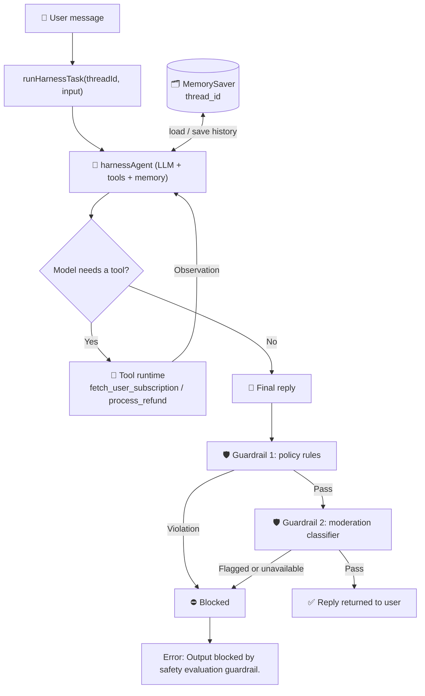

# Version 1: Single-Agent Harness with Guardrails

> Solution and feature document for **v1** of the AI harness. It covers one slice of the wider plan in [ai-harness-high-level-plan.md](./ai-harness-high-level-plan.md) (Example 1, the single-agent harness). Multi-agent routing and the LLM-as-a-Judge gate are out of scope for v1.

| | |
| --- | --- |
| **Code** | `src/v1/` |
| **Run** | `npm run harness` (runs `tsx src/v1/main.ts`) |
| **Stack** | TypeScript, Node.js, LangChain (`createAgent`), LangGraph `MemorySaver`, Zod, OpenAI `gpt-4o-mini` |
| **Config** | `OPENAI_API_KEY` in `.env` (loaded by `dotenv/config` in `main.ts`) |

---

## 1. Overview

### What we are trying to achieve

Build a small but production-shaped **agent harness**: a customer-support agent that can look up a subscription and issue a refund, wrapped in the infrastructure that makes this safe to run. The LLM is the brain, and v1 builds the body around it:

| Harness concern | v1 implementation |
| --- | --- |
| **Tools** | `fetch_user_subscription` (DB lookup) and `process_refund` (external action), both mocked and Zod-validated |
| **Memory / state** | `MemorySaver` checkpointer keyed by `thread_id`, so follow-up turns remember earlier ones |
| **Control** | A system prompt that tells the model to verify the subscription before any action and to refund only `active` users |
| **Safety** | A guardrail that runs *after* the agent finishes and decides whether the reply may reach the user |

### Goals

- Show the **Reason → Act → Observe** loop end to end with real tool calls.
- Keep safety **outside the model**. The prompt asks the model to behave, and the guardrail checks that it did.
- Keep the code small and split by responsibility, so later versions (multi-agent, judge gate) extend it instead of rewriting it.

### Non-goals (v1)

- Multi-agent routing, parallel sub-agents, aggregation (see Example 2 of the plan).
- LLM-as-a-Judge evaluation and repair or retry loops.
- Input-side guardrails (prompt-injection or scope checks on the user message).
- Durable storage, tracing, human approval flows (see [Future work](#8-future-work)).

---

## 2. Flow diagram



### Step-by-step

| # | Step | Where | What happens |
| --- | --- | --- | --- |
| 1 | **Receive** | `main.ts` | `main()` calls `runHarnessTask(threadId, message)`. The `threadId` identifies the conversation. |
| 2 | **Invoke the agent** | `runHarnessTask.ts` | The message is wrapped in a `HumanMessage` and passed to `harnessAgent.invoke(...)` with `{ configurable: { thread_id } }`. |
| 3 | **Load memory** | `harnessAgent.ts` | The `MemorySaver` checkpointer restores earlier messages for that `thread_id`. |
| 4 | **Reason** | LLM | The model reads the system prompt and history and decides on the next step. |
| 5 | **Act** | `tools/` | If the model emits tool calls, the harness validates the arguments with Zod, runs the tool and returns the result. |
| 6 | **Observe, then loop** | LangChain agent | The tool result goes back to the model. Steps 4 to 6 repeat until the model replies without a tool call. |
| 7 | **Extract reply** | `runHarnessTask.ts` | The last message in the result is the final text. The full message list (including tool calls) is kept for the guardrail. |
| 8 | **Policy rules** | `guardrail.ts` | Deterministic rules inspect this turn's tool calls and the reply. Any violation blocks the reply. |
| 9 | **Classifier** | `guardrail.ts` | The reply goes to OpenAI's moderation model. A flagged result, or a failed call, blocks the reply. |
| 10 | **Deliver or block** | `runHarnessTask.ts` | On pass the reply is returned. On block the user gets a generic error and the reason is logged. |

### Example turn (the demo in `main.ts`)

1. *"Hi, my user ID is user_123. Can you please refund $50 for my last invoice?"*
   The agent calls `fetch_user_subscription("user_123")` and gets `status: "active"`. It then calls `process_refund(user_123, 50)` and gets a `refundId`, and replies with confirmation. The guardrail passes it.
2. *"What was the refund status and ID you just generated?"*
   This runs in the **same thread**. The agent answers from memory with no tool calls.

---

## 3. Architecture and components

```text
src/v1/
├── main.ts                      # Demo runner (loads .env, runs two turns)
├── tools/
│   ├── fetchUserSubscriptionTool.ts   # Mock DB lookup
│   ├── processRefundTool.ts           # Mock refund action
│   └── index.ts                       # Exports both tools
└── harness/
    ├── harnessAgent.ts          # Model + tools + memory + system prompt
    ├── runHarnessTask.ts        # Orchestrates one turn: agent, then guardrail
    └── guardrail.ts             # Policy rules + moderation classifier
```

| Component | Responsibility |
| --- | --- |
| `harnessAgent.ts` | Builds the agent with `createAgent({ model, tools, checkpointer, systemPrompt })`. The model is `gpt-4o-mini` at `temperature: 0`. |
| `tools/*` | Schema-validated functions the agent may call. Both are mocks: the lookup uses an in-memory table (`user_123` active, `user_456` canceled) and the refund returns a fake `refundId`. |
| `runHarnessTask.ts` | The single entry point for a turn. It runs the agent, then the guardrail, and returns either the reply or the block message. |
| `guardrail.ts` | `evaluateTurn(messages, reply)` returns `{ allowed: true }` or `{ allowed: false, reason }`. |
| `main.ts` | Loads `.env`, then runs the two-turn demo. |

---

## 4. Guardrail design

The guardrail is independent of the LLM, so it still protects the system if the model ignores its prompt. It has two layers, and the cheap deterministic one runs first.

### Layer 1: policy rules (deterministic)

Each rule is a function that gets the current turn (tool calls, parsed subscription results, reply) and returns a violation string or `null`. "Current turn" means every message after the last human message, so earlier turns in the thread don't count.

| Rule | Blocks when |
| --- | --- |
| **Verified active subscription** | `process_refund` was called, but no `fetch_user_subscription` result this turn has `status: "active"` |
| **Refund cap** | a refund amount is greater than `MAX_REFUND_USD` ($100) |
| **No secret leakage** | the reply matches an API-key, card-number or private-key pattern |

To add a rule, write a `Rule` function and append it to `RULES`.

### Layer 2: moderation classifier (ML)

The reply is sent to OpenAI's `omni-moderation-latest` endpoint (5 second timeout). It catches harmful content that rules can't express (hate, violence, self-harm and similar). It **fails closed**: if the call errors or times out, the reply is blocked.

### Why the policy rules check tool calls, not just text

Rules like "refund only if active" are about what the agent *did*, not what it *said*. Checking the recorded tool calls enforces the business rule even if the model skips the lookup or sends a bad amount. Blocking after the fact does not undo a refund that already ran. See the first item in [Limitations](#7-limitations-and-known-gaps).

---

## 5. Key design decisions

| Decision | Rationale |
| --- | --- |
| Guardrail in code, not only in the prompt | Prompts are requests, code is enforcement. |
| Rules first, classifier second | Rules are free and instant. The network call only happens for replies that pass the rules. |
| Fail closed | An unavailable safety check must not become an open door. |
| One `evaluateTurn` entry point | `runHarnessTask` stays simple, and the guardrail can change internally without touching it. |
| Generic message to the user, specific reason in logs | The user learns nothing about the rules. Operators can still debug. |
| Mocked tools | Keeps v1 runnable with only an OpenAI key, while the schemas stay realistic. |

---

## 6. Setup and running

```powershell
npm install
# .env
OPENAI_API_KEY=your_key_here

npm run harness
```

Expected output: for each turn, the user input, any `[Harness Executing Tool]` lines, then `[FINAL HARNESS OUTPUT]`. A blocked reply prints `[Harness Safety Evaluation]: BLOCKED ...` and returns the generic error.

---

## 7. Limitations and known gaps

1. **Guardrail is not yet wired in.** `guardrail.ts` is implemented, but `runHarnessTask.ts` currently runs the older keyword check (`unauthorized_access_code`), and the `evaluateTurn` call is commented out. To enable v1 as designed, remove the keyword check and uncomment the `evaluateTurn` block.
2. **Checks run after the tools.** The guardrail evaluates the finished turn. A refund that already executed is not rolled back when the reply is blocked. Production should gate `process_refund` **before** execution (a pre-tool check or human approval).
3. **No input guardrail.** User messages are not screened for prompt injection or out-of-scope requests.
4. **Moderation scope.** The classifier covers harmful content, not business risk. Business rules live in the policy layer and are only as complete as `RULES`.
5. **In-memory state.** `MemorySaver` loses all history on restart and doesn't share it across processes.
6. **Mock data.** Subscriptions and refunds are simulated.
7. **Untested.** There are no automated tests for the rules yet.

---

## 8. Future work

Ordered roughly by value:

1. Wire `evaluateTurn` into `runHarnessTask` and remove the keyword check.
2. Pre-execution gate on `process_refund` (limits, human approval above a threshold).
3. Unit tests for each rule, using synthetic message lists.
4. Input guardrail (classifier-based injection and scope check).
5. Durable checkpointer (Postgres or Redis) and tracing (LangSmith).
6. Retry and timeout limits on the agent loop.
7. Evolve toward the router, parallel sub-agents, aggregator and LLM-as-a-Judge gate described in [ai-harness-high-level-plan.md](./ai-harness-high-level-plan.md).
